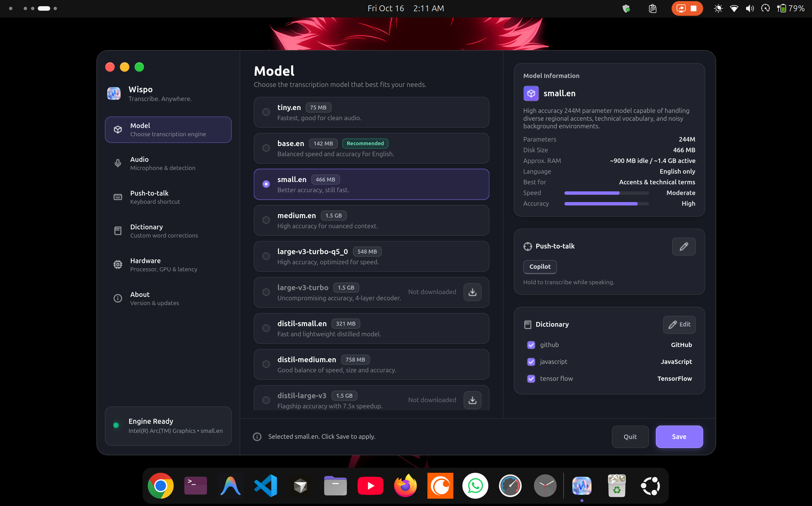
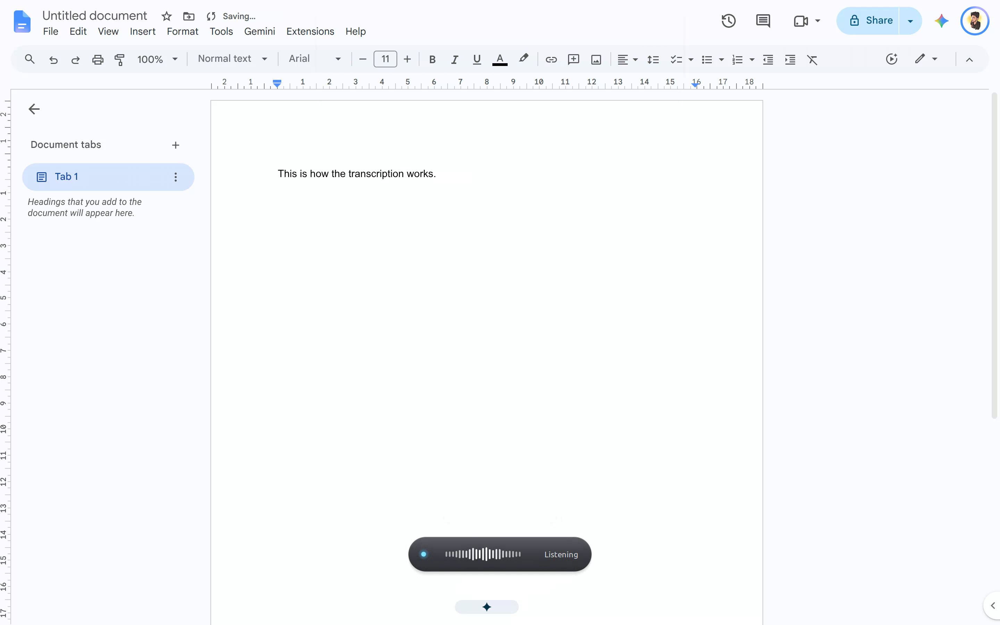

# Wispo

> **Alpha — actively developed.** Core dictation works and is used daily. Many planned features are not yet implemented.

Local, push-to-talk speech dictation for Linux. Hold a key, speak, release — Wispo records from your microphone, transcribes speech with a local `whisper.cpp` model, and types the finished text into whatever application you are focused on through the XDG RemoteDesktop portal.

I built Wispo for my own use case because Whisper Flow isn't officially available on Linux, and the open-source alternatives I tried didn't perform as well as I wanted on my Intel integrated GPU.

So, I decided to build my own local transcription software, optimized around my hardware and workflow.

If you're on macOS or Windows, Whisper Flow is still an excellent choice. Wispo exists to bring a similar kind of experience to Linux users, particularly those using Intel processors.

Wispo is completely free, with no word limits and no telemetry. I built it to solve a problem I faced myself, and I decided to open-source it so that others facing the same challenges could benefit from it too. If Wispo makes life a little easier for someone like me, then it's doing exactly what I built it for.

<p align="center">
  
</p>

---

## Project Scope

Wispo is built for local, hold-to-talk dictation on a Linux desktop, with Intel Arc/SYCL as its primary development target. It is an alpha project: the core pipeline is implemented, but hardware, driver, desktop-shell, and portal behavior still need validation on each target machine.

The current scope is deliberately narrow:

- local Whisper inference through `whisper.cpp`;
- Linux input-event hotkeys and the XDG RemoteDesktop portal;
- GTK4 desktop configuration and feedback;
- Intel SYCL or CPU runtime selection from the current native build. NPU acceleration is planned, but not implemented.

NPU, CUDA, and Vulkan backends are not implemented in this repository.

---

## Current Status

**Alpha.** The repository implements the core pipeline — hotkey → microphone → whisper.cpp → portal injection. Expect rough edges and validate the build, portal permission, microphone, and hotkey behavior on your own system before relying on it for regular work.

### Platform support

| Platform                                | Status                                                     |
| --------------------------------------- | ---------------------------------------------------------- |
| Intel Arc GPU (SYCL) on Linux           | Implemented; primary development target                    |
| CPU backend on Linux                    | Implemented runtime selection; validate on target hardware |
| NPU Acceleration (Intel NPU / OpenVINO) | Not implemented                                            |
| NVIDIA GPU (CUDA)                       | Not implemented                                            |
| Vulkan                                  | Not implemented                                            |
| macOS / Windows                         | Not supported by the current implementation                |

### Installation methods

| Method | Compatibility | Status |
| --- | --- | --- |
| **Ubuntu 26.04 x86_64 tarball (`.tar.gz`)** | Ubuntu 26.04 with its matching Python runtime, GTK bindings, and a compatible oneAPI runtime | Preview |
| **Debian / Ubuntu package (`.deb`)** | Debian-family x86_64 systems with Python 3.12+ and a compatible oneAPI runtime | Preview |
| **From source** | Linux x86_64 with Intel oneAPI SYCL and Python 3.12+ | Available |

#### Quick install (offline tarball)

The release archive is an **Ubuntu 26.04 x86_64** bundle, not a universal-Linux archive. It includes Wispo, `whisper.cpp`/GGML libraries, and a locked offline wheelhouse for `jeepney`, NumPy, Pillow, psutil, and PyYAML. The installer never contacts PyPI.

Before installing, provide the host components that cannot be safely bundled: the matching Python runtime and venv support, GTK/PyGObject, audio libraries, and Intel oneAPI runtime. On the tested Ubuntu target:

```bash
sudo apt update
sudo apt install -y python3 python3-venv python3-gi gir1.2-gtk-4.0 libasound2
```

Install Intel oneAPI as described in [Step 4](#step-4--install-the-intel-oneapi-sycl-compiler) and [Step 5](#step-5--install-onemkl-and-level-zero-development-files) below. The current native build dynamically links oneAPI runtime libraries even when `asr.device: cpu` is selected.

1. Download `wispo-*-ubuntu-26.04-x86_64.tar.gz` and `SHA256SUMS` from [GitHub Releases](https://github.com/Master-Faraz/Wispo/releases).
2. Verify the archive checksum:
   ```bash
   sha256sum -c SHA256SUMS
   ```
3. Extract the archive and run the installer:
   ```bash
   tar -xzf wispo-*-ubuntu-26.04-x86_64.tar.gz
   cd wispo
   sudo ./install.sh
   ```
4. Launch **Wispo** from your Application Menu or run `wispo` in any terminal.

To uninstall at any time:

```bash
sudo /opt/wispo/uninstall.sh
```

---

## What It Does

<p align="center">
  
</p>

- **Local inference**: Audio capture, voice activity detection, and speech transcription run on your machine. Wispo does not send microphone audio or transcripts to a remote transcription service.
- **Local logs and optional network requests**: The desktop service writes diagnostic logs, including final transcripts, to `~/.local/state/wispo/service.log`. Model downloads contact the configured Hugging Face / ggml repositories; an explicit `wispo update` or Settings update check contacts GitHub Releases. Neither sends microphone audio or transcripts.
- Reads a configurable hold-to-talk chord from Linux input devices (the Copilot key by default).
- Captures 16 kHz mono audio through ALSA (including PipeWire's ALSA plugin), runs voice activity detection, and sends speech frames through a sliding window to whisper.cpp.
- On key release, re-transcribes the full utterance, applies the configured replacement dictionary, and injects the final text into the focused application via the XDG RemoteDesktop portal.
- Provides a GTK4 settings window, a click-through recording HUD, a desktop launcher entry, and a D-Bus status item.

The desktop portal may prompt for keyboard permission before Wispo can inject keystrokes. It can prompt again after permission is revoked or a portal session cannot be restored.

---

## Requirements

Wispo is a Linux desktop application.

> **Tested Environment**: **Ubuntu 26.04 LTS (GNOME Shell / Wayland)**.
> The installation guide uses Debian/Ubuntu `apt` packages. On other distributions (Fedora, Arch, openSUSE), use the equivalent packages for your system.
>
> ⚠️ **Build-Time vs. Runtime Note**:
> Wispo compiles whisper.cpp and the native wrapper library `libwispo_asr.so` using Intel's SYCL toolchain (`icpx` and `oneMKL`). Therefore, **Intel oneAPI is currently a build-time requirement for all source builds**, regardless of whether you select GPU or CPU at runtime. After a successful build, `asr.device: sycl` requests the Level Zero GPU path, while `asr.device: cpu` selects the CPU path. A compiler-agnostic pure CPU build is not implemented.

**Prerequisites:**

- Python 3.12 or newer and [`uv`](https://docs.astral.sh/uv/).
- GTK4 and PyGObject (`python3-gi`, `gir1.2-gtk-4.0`).
- ALSA development and runtime libraries. PipeWire with its ALSA plugin is recommended.
- A desktop portal implementation that supports the RemoteDesktop keyboard permission (GNOME ships one).
- `cmake`, a C/C++ build toolchain, and `curl`.
- A compatible `whisper.cpp` source tree at `third_party/whisper.cpp`.
- **Global Shortcut Permission (`/dev/input/event*`)**:
  Wispo requires permission to read Linux input event devices so it can intercept your push-to-talk shortcut in the background across all applications without grabbing active keyboard focus. On most distributions, add your user to the `input` group:
  ```bash
  sudo usermod -aG input $USER
  # Sign out and log back in before continuing
  ```
  > ⚠️ **Security Note**: Adding your user to the `input` group gives processes running under your user account read access to all system input devices. This is necessary for background shortcut detection without X11 grabs, but you should understand the security implications on shared or untrusted systems.

---

## Installation from Source

### Step 1 — Clone the repository

```bash
git clone https://github.com/Master-Faraz/Wispo.git wispo
cd wispo
```

### Step 2 — Get the whisper.cpp source

The repository does not yet bundle `whisper.cpp` as a proper submodule. Clone it manually:

```bash
git clone --depth 1 https://github.com/ggml-org/whisper.cpp.git third_party/whisper.cpp
```

### Step 3 — Install system packages

```bash
sudo apt update
sudo apt install -y \
  build-essential \
  cmake \
  pkg-config \
  gpg \
  wget \
  python3-gi \
  gir1.2-gtk-4.0 \
  libasound2-dev \
  libze1 \
  libze-intel-gpu1 \
  intel-opencl-icd
```

### Step 4 — Install the Intel oneAPI SYCL compiler

Intel's DPC++ compiler (`icpx`) is required to compile `libwispo_asr.so` and whisper.cpp's native backend.

Add Intel's APT repository and install the compiler:

```bash
wget -O- https://apt.repos.intel.com/intel-gpg-keys/GPG-PUB-KEY-INTEL-SW-PRODUCTS.PUB \
  | gpg --dearmor \
  | sudo tee /usr/share/keyrings/oneapi-archive-keyring.gpg > /dev/null

echo "deb [signed-by=/usr/share/keyrings/oneapi-archive-keyring.gpg] https://apt.repos.intel.com/oneapi all main" \
  | sudo tee /etc/apt/sources.list.d/oneAPI.list

sudo apt update
sudo apt install -y intel-oneapi-compiler-dpcpp-cpp
```

### Step 5 — Install oneMKL and Level Zero development files

oneMKL is linked during compilation of the native engine:

```bash
sudo apt install -y intel-oneapi-mkl-devel-2026.1 libze-dev
```

> **Note on versioning:** `intel-oneapi-mkl-devel-2026.1` matches the tested environment on Ubuntu 26.04 LTS. If your repository provides a different version, install `intel-oneapi-mkl-devel` without the version suffix.

### Step 6 — Verify the Intel oneAPI setup

```bash
icpx --version   # should print the DPC++ compiler version
sycl-ls          # should list your Arc GPU under [level_zero:gpu]
```

> **CPU runtime note:** If you intend to select the CPU path (`asr.device: cpu`), `icpx --version` must work for compilation but a Level Zero GPU is not required for runtime selection. Test an actual transcription on the target machine after building. For GPU acceleration, verify that your Arc GPU is listed under `[level_zero:gpu]`.

### Step 7 — Install `uv` and create the Python environment

```bash
curl -LsSf https://astral.sh/uv/install.sh | sh
source ~/.bashrc   # or open a new terminal

uv sync            # installs all Python dependencies into .venv
```

### Step 8 — Build the native engine bridge

```bash
bash scripts/build_sycl.sh
```

This script sources the oneAPI environment automatically and compiles:

- `third_party/whisper.cpp/build-sycl/bin/whisper-cli`
- `native/build/libwispo_asr.so`

Once compiled, you can run inference using your Intel Arc GPU (`asr.device: sycl` / `auto`) or run purely on CPU (`asr.device: cpu`) by setting it in [`wispo.yaml`](wispo.yaml) or through the Settings GUI.

### Step 9 — Download a model

```bash
bash scripts/download_model.sh small.en
```

Model files are stored in `models/` and are ignored by Git. Installed packages store downloaded models in `~/.local/share/wispo/models/` by default. The settings window can also download catalogue models. See the [model guide](#models) below.

---

## Models

> **Model-selection note:** Real-world transcription speed, latency, and accuracy vary with the model file, CPU/GPU, driver, thread count, audio, and language. The table identifies the models exposed by the application; measure them with `uv run wispo benchmark --wav /path/to/sample.wav` before drawing performance conclusions for a target machine.

| Model                 | Size    | Recommended use                  |
| --------------------- | ------- | -------------------------------- |
| `tiny.en`             | 75 MB   | Small English model              |
| `base.en`             | 142 MB  | Compact English model            |
| `small.en`            | 466 MB  | Checked-in configuration default |
| `medium.en`           | 1.5 GB  | Larger English model             |
| `large-v3-turbo-q5_0` | 548 MB  | Quantized Turbo model            |
| `large-v3-turbo`      | 1.5 GB  | Turbo model                      |
| `distil-small.en`     | 321 MB  | Distilled small model            |
| `distil-medium.en`    | 758 MB  | Distilled medium model           |
| `distil-large-v3`     | 1.5 GB  | Distilled large model            |
| `distil-large-v3.5`   | 1.45 GB | Distilled large v3.5 model       |

The settings window lists these models and can download them. `small.en` is the checked-in default; choose a model after validating accuracy and latency on your own hardware.

---

## Run

Start the background dictation service:

```bash
uv run python -m wispo.service
```

On first start, grant the portal keyboard-input permission when GNOME prompts you. Hold the configured shortcut (the Copilot key by default), speak, then release to insert the completed transcript. A small HUD appears while recording.

**Closing the settings window hides it; the service keeps running in the background.** To stop the service completely, choose **Quit** in the UI or run:

```bash
uv run python -m wispo.service --quit
```

To reopen the settings window from the terminal (when the service is already running):

```bash
uv run python -m wispo.service
```

A second invocation detects the running service and opens its settings window instead of starting a new listener.

Open the settings window standalone (without background dictation):

```bash
uv run python -m wispo.settings
```

### Desktop launcher entry

The first time you run `wispo.service`, it installs a `.desktop` entry at:

```
~/.local/share/applications/com.wispo.Wispo.desktop
```

This creates a **Wispo** launcher in the GNOME application grid and dock. Clicking it opens the settings window or brings the running service to the foreground — you do not need to use the terminal after the first run.

To install the desktop entry manually without starting the full service:

```bash
uv run python -c "
from wispo.desktop import install_desktop_entry
import sys
install_desktop_entry(sys.executable, '$(pwd)')
"
```

### Command-line tools

Once installed (or via `uv run wispo <command>` in developer checkout):

```bash
# Launch background desktop service (default)
wispo

# Open the GTK4 settings configuration window
wispo settings

# Check for new releases and updates from GitHub
wispo update

# Print current installed version
wispo --version

# Print partial and final transcripts in the terminal
wispo transcribe

# Inject the final phrase through the desktop portal
wispo transcribe --inject

# Measure one 16 kHz, 16-bit PCM WAV file
wispo benchmark --wav /path/to/sample.wav
```

Equivalent module entry points: `python -m wispo.service`, `python -m wispo.settings`, `python -m wispo.transcribe`, and `python -m wispo.benchmark`.

---

## Configuration & Hardware Tuning

> ⚠️ **Important: Tweak Hardware Settings for Your Laptop**
>
> The checked-in [`wispo.yaml`](wispo.yaml) defaults are configured specifically for the author's laptop hardware (Intel Arc integrated graphics, CPU thread layout, and dedicated physical Copilot key).
>
> **You will need to tweak the hardware settings to make sure you are using a stable configuration for your laptop.** Running defaults mismatched to your hardware may cause high CPU load, system stutter, or driver hangs.
>
> You can adjust all settings interactively through the **GTK4 Settings GUI** (`uv run python -m wispo.settings`), or by editing [`wispo.yaml`](wispo.yaml) directly.

### Recommended Laptop Adjustments

1. **CPU Inference Threads (`asr.threads`)**:
   - Default: `4`.
   - In the GUI **Hardware** tab, click **⚡ Auto Recommend** or set the slider to `(Total Logical Cores - 2)`. Setting threads too high can starve your desktop environment and trigger thermal throttling; setting it too low increases transcription latency.
2. **Compute Device (`asr.device`)**:
   - `sycl`: Uses Intel Arc GPU via Level Zero.
   - `auto`: Probes Level Zero GPU first, safely falling back to CPU.
   - `cpu`: Pure CPU inference. If your GPU has limited memory or your distribution's Intel drivers encounter Level Zero errors, switch to CPU for rock-solid stability.
3. **Push-to-Talk Shortcut (`hotkey.keys`)**:
   - Default: `copilot`.
   - If your laptop keyboard does not have a dedicated physical Copilot key, open the GUI **Push-to-talk** tab and choose an ergonomic preset (such as `Right Ctrl`, `Alt + Space`, or `Super + H`) or record a custom chord with **Shortcut Studio**.
4. **Performance & Latency Profiles (`streaming.*`)**:
   - In the GUI **Hardware** tab:
     - **Snappy** (500 ms chunk / 3000 ms buffer), **Balanced** (1000 ms / 5000 ms), and **Power Saver** (2000 ms / 7000 ms) change intermediate-window settings.
     - These affect terminal partials and inference work; the desktop service injects only the final transcript after key release. Benchmark on your hardware rather than treating them as guaranteed latency or power profiles.
5. **Microphone & VAD Sensitivity (`audio.device` & `vad.*`)**:
   - In the GUI **Audio** tab, click **▶ Test Microphone** to monitor the live VU meter and test voice trigger response.
   - Use the presets: **Quiet** (sensitive microphones / quiet rooms), **Balanced** (standard), or **Noisy** (cafes or loud laptop fan environments). The high-pass filter slider attenuates low-frequency desk vibrations and HVAC rumble.

---

### Settings Available in the GUI

Wispo includes a dedicated, full-featured GTK4 configuration application. Launch it with `uv run python -m wispo.settings` or by clicking **Wispo** in your desktop application grid.

| Settings Tab                      | Configurable Features & Options                                                                                                                                                                                                                                                                                                                                                                                                                                                                                                                  |
| --------------------------------- | ------------------------------------------------------------------------------------------------------------------------------------------------------------------------------------------------------------------------------------------------------------------------------------------------------------------------------------------------------------------------------------------------------------------------------------------------------------------------------------------------------------------------------------------------ |
| **Model** (`model`)               | • Browse catalogue of supported models (`tiny.en` to `large-v3-turbo`, `distil-*`).<br>• One-click model downloading with real-time progress indicators.<br>• Switch active models without editing configuration files.<br>• View model disk size, parameter count, and quantization details.                                                                                                                                                                                                                                                    |
| **Audio** (`audio`)               | • **Live VU Meter** and microphone test without text injection.<br>• **Input Device Selector**: lists PipeWire sources discovered through `wpctl` and captures through ALSA/PipeWire ALSA.<br>• **VAD Sliders**: RMS energy threshold, trailing silence (hangover ms), and high-pass rumble filter (Hz).<br>• **One-Click Presets**: _Quiet_, _Balanced_, and _Noisy_. |
| **Push-to-talk** (`push_to_talk`) | • **Shortcut Studio**: Visual keycap chip display and live keyboard chord recorder.<br>• **Hardware Presets**: _Copilot Key_ (single key), _Right Ctrl_ (single key), _Ctrl + Super + Space_ (Raycast/Spotlight style), _Alt + Space_ (thumb chord), _Super + H_ (standard dictation).<br>• Single-click reset to default shortcut.                                                                                                                                                                                                              |
| **Dictionary** (`dictionary`)     | • **Vocabulary Replacements**: Correct phonetic misrecognitions or format domain jargon (e.g. `github` → `GitHub`, `open a i` → `OpenAI`).<br>• Interactive rule composer with instant add, per-rule toggle switch (enable/disable), and delete buttons.                                                                                                                                                                                                                                                                                         |
| **Hardware** (`hardware`)         | • **Inference CPU Threads**: Slider with **⚡ Auto Recommend** core calculation.<br>• **Compute Device**: Choose _Auto-Detect_, _GPU Acceleration (Intel SYCL)_, or _CPU Only (Safe Fallback)_.<br>• **GPU Device Index**: Multi-GPU target selector (`0`, `1`, etc.).<br>• **Latency Profiles**: _Snappy_, _Balanced_, or _Power Saver_ presets.<br>• **Spoken Language**: Dropdown supporting English, Spanish, French, German, Hindi, Chinese, Japanese, Italian, Portuguese, Russian, Korean, or Auto-Detect (requires multilingual models). |
| **Engine Inspector**              | • Persistent bottom-left status card showing real-time Engine Status (_Ready_, _Recording_, _Transcribing_), active model, compute backend, and memory profile.                                                                                                                                                                                                                                                                                                                                                                                  |

---

### Direct YAML Configuration (`wispo.yaml`)

Use the Settings window's **Save** action to write settings. In a source checkout it writes [`wispo.yaml`](wispo.yaml) at the repository root; installed packages write `~/.local/share/wispo/wispo.yaml` by default. You can also edit the active file directly:

```yaml
audio:
  sample_rate: 16000
  channels: 1
  device: auto # auto, default, pipewire, or a PipeWire node name
  frame_ms: 30

asr:
  backend: whisper_cpp
  model: small.en
  model_path: models/ggml-small.en.bin
  device: auto # auto, sycl, or cpu
  quantization: fp16
  threads: 4
  language: en
  gpu_device: 0

streaming:
  chunk_ms: 1000
  overlap_ms: 250
  length_ms: 5000

vad:
  rms_threshold: 0.015
  noise_multiplier: 4.0
  hangover_ms: 700
  preroll_ms: 300
  highpass_hz: 80.0

dictionary:
  - phrase: github
    replacement: GitHub
    enabled: true
  - phrase: open a i
    replacement: OpenAI
    enabled: true

hotkey:
  keys: [copilot]
```

> **Note:** The background service can apply dictionary, VAD, microphone, and shortcut changes while running. If you change hardware compute devices (`sycl` / `cpu`), threads, model, or language, restart `wispo.service` to apply changes cleanly.

See [the configuration reference](docs/configuration.md) for all options and tuning guidance.

---

## Known Limitations

- **US QWERTY keymap only.** Text injection translates characters to US keyboard-layout evdev codes. If a transcript contains an unsupported character, injection aborts and Wispo logs an error; it does not silently omit that character.
- **Intel Arc GPU only for GPU acceleration.** NPU, NVIDIA CUDA, and Vulkan backends are not implemented.
- **Linux only.** macOS and Windows are not supported by the current implementation.
- **GNOME tray icon requires an extension.** The status icon uses the `org.kde.StatusNotifierItem` protocol, which requires the [AppIndicator Support](https://extensions.gnome.org/extension/615/appindicator-support/) GNOME Shell extension to be visible in the top bar. Without it, the service still runs — you just won't see the tray icon.
- **Full-utterance transcription is capped at 30 seconds.** Longer recordings use accumulated rolling windows.
- **No `/dev/uinput` fallback.** Text injection requires the XDG RemoteDesktop portal. It fails if the portal is unavailable or permission is denied.

---

## Architecture

The core data flow:

```text
Linux input events ──> hold-to-talk state
                                 │
ALSA / PipeWire microphone ─> float32 frames ─> VAD + preroll ─> rolling windows
                                                                      │
                                                              whisper.cpp bridge
                                                              (SYCL or CPU)
                                                                      │
                                     final utterance ─> dictionary replacement ─> portal keycodes
                                                                                         │
                                                                                focused application
```

The model remains loaded between utterances. Intermediate windows support terminal partials. When recording ends, Wispo re-transcribes the full utterance (up to 30 seconds) for the final result.

See [Architecture](docs/architecture.md) for module ownership, threading, and concurrency details.

---

## Troubleshooting

**Hotkey does nothing / "no keyboard was readable"**
Your user is not in the `input` group. Run `sudo usermod -aG input $USER`, sign out, sign back in, then try again.

**"model not found" on startup**
Run `bash scripts/download_model.sh small.en` (or the model name in your `wispo.yaml`).

**"libwispo_asr.so is not built yet"**
Run `bash scripts/build_sycl.sh`. Make sure oneAPI is installed first.

**Portal permission dialog never appeared / timed out**
The portal Start call waits up to 3 minutes. If a dialog appeared and you missed it, restart the service. If no dialog appears, check that `xdg-desktop-portal-gnome` is running.

**"device is set to sycl, but sycl-ls did not list a Level Zero GPU"**
Either set `asr.device: cpu` in `wispo.yaml`, or investigate the Level Zero driver installation (`libze1`, `libze-intel-gpu1`, `intel-opencl-icd`).

**Tray icon not visible in GNOME**
Install the [AppIndicator Support](https://extensions.gnome.org/extension/615/appindicator-support/) extension. The service is running regardless; use the settings window or `--quit` flag.

**Text is not being typed / an unsupported-character error is logged**
The injection keymap is US QWERTY only. A character outside that layout aborts the insertion. Use supported characters or update the keymap before retrying.

---

## Development

Read [Contributing](CONTRIBUTING.md) before changing the code. In a headless shell, run the non-GUI tests with:

```bash
UV_CACHE_DIR=/tmp/wispo-uv-cache uv run pytest -q -k 'not hud'
```

The complete suite includes a HUD test that needs a graphical display. Run it locally with a display or `xvfb-run`.

---

## License

This project is licensed under the [MIT License](LICENSE).
