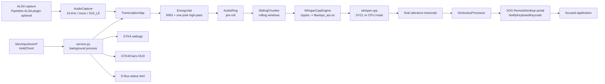

# Wispo architecture

This document describes the implementation that is present in this repository. It does not promise a particular latency, accuracy, desktop compatibility level, or GPU speed; use `wispo benchmark` on the target machine for measurements.

## System view



## Components and responsibilities

### Entry points and process lifecycle

- `wispo.service` is the desktop-service entry point. It installs a local desktop-entry file, claims `org.wispo.Service` on the session bus, opens the settings UI, and starts the listener worker.
- A second service invocation asks the running service to present its settings window instead of starting another listener.
- Closing settings hides the window. The explicit **Quit** action requests shutdown, stops the listener, closes status integration, and closes the HUD.
- `wispo.settings` runs the settings UI alone. `wispo transcribe` and `wispo benchmark` are the terminal audio and latency evaluation entry points. `wispo update` checks GitHub Releases for new binary distributions.
- The offline Linux tarball creates `/opt/wispo/venv` from its checked, bundled wheelhouse. `/usr/bin/wispo` uses that venv when it exists; Debian packages use distribution-provided Python dependencies. Both expose bundled `whisper.cpp`/GGML libraries and set `WISPO_DATA_DIR` to the user's XDG data directory.

The service creates files outside the checkout:

- a desktop entry and resized icons under `~/.local/share/`;
- a portal restore token and service log under `~/.local/state/wispo/`.

### Global hold-to-talk

`wispo.hotkey.linux.HoldChord` reads Linux `input_event` records from readable `/dev/input/event*` devices. It tracks key press/release state and sets a `threading.Event` only while every configured key is held. This requires input-device permission; it is not implemented as an X11 global shortcut.

The default configuration currently uses `copilot`. Supported names and key-code mapping live in `hotkey/linux.py`. A bare `super` shortcut receives special handling because GNOME's overview key can consume it.

### Audio capture and microphone selection

`AudioCapture` opens ALSA through `ctypes` as one interleaved S16_LE channel. It requests the configured sample rate—normally 16 kHz—and converts frames to `numpy.float32` before handing them to the transcription pipeline.

`audio.device: auto` uses `wpctl status` and `wpctl inspect` to prefer a PipeWire digital microphone source, then routes ALSA's `pipewire` device to that source. `default`, `pipewire`, and an explicit PipeWire node name are also accepted. This selection logic assumes the relevant tools and PipeWire ALSA plugin are available.

### Segmentation and streaming transcripts

`TranscriptionApp` owns the state of one recording session:

1. It reads microphone frames and maintains an unfiltered pre-roll ring buffer.
2. `EnergyVad` runs a one-pole high-pass copy of each frame through an RMS/noise-floor gate. The raw samples, not the filtered samples, go to Whisper.
3. On speech onset, it prepends the pre-roll frames and feeds speech to `SlidingChunker`.
4. Each `chunk_ms` of new audio produces a rolling window whose maximum length is `length_ms`. Consecutive windows therefore overlap.
5. `TranscriptAccumulator` merges textual overlap from intermediate Whisper calls.
6. On release or after VAD ends speech, the app re-transcribes the complete utterance when it is at most 30 seconds. Longer recordings rely on accumulated windows plus the final tail.

In hold-to-talk operation, the service passes `force_speech=True` and `transcribe=False` while recording. Only RMS audio energy is computed to drive the HUD waveform bars, keeping the GPU and shared memory bus idle while the user speaks. When the key is released, the complete utterance is transcribed in a single high-accuracy pass.

### Power management and system suspend/resume

`wispo.service` subscribes to `org.freedesktop.login1.Manager.PrepareForSleep` on the system D-Bus:

- **Before Suspend (`about_to_sleep=True`)**: The service pauses audio capture, resets hotkey listeners, and closes the active ASR engine context (`app.engine.close()`).
- **On Resume (`about_to_sleep=False`)**: Because Intel Level Zero device handles, command queues, and device USM allocations do not survive Linux S0ix / modern standby, the service automatically re-initializes the Whisper engine and Level Zero context (`app.reload_model`), preventing kernel GPU hangs (`i915`) upon wake.

### Native inference

`WhisperCppEngine` is a Python `ctypes` wrapper around `native/wispo_asr.cpp`, which exposes a small C ABI over `whisper.cpp`. It loads model weights once, warms the engine with a silent inference, and keeps the Whisper context resident between utterances.

The build script configures `whisper.cpp` with `GGML_SYCL=ON` and creates `native/build/libwispo_asr.so`. Device selection is intentionally separate from compilation:

- `auto` queries `sycl-ls` and uses a detected Level Zero GPU; it otherwise selects CPU. The result is cached in `~/.local/state/wispo/device_cache.json` (7-day TTL) for fast startup without re-sourcing oneAPI environment scripts.
- `sycl` requires a detected Level Zero GPU and fails if one is unavailable.
- `cpu` bypasses GPU selection and runs Whisper on CPU cores with zero GPU memory bus impact.

This is one SYCL-enabled native build, not independently documented CPU and GPU builds. oneAPI runtime libraries must be discoverable when it starts.

### Post-processing and text insertion

`DictionaryProcessor` performs configured phrase replacement after the final transcript is available. It does not alter the model or bias decoding.

`PortalKeyboard` creates an XDG RemoteDesktop session and asks for keyboard permission. It normalizes typographic characters (curly quotes, dashes, ellipses, non-breaking spaces) to US ASCII equivalents, translates them to evdev keycodes, and sends them via `NotifyKeyboardKeycode` to the active portal session. It persists a restore token with mode `0600` so a desktop can restore consent in later runs.

There is no `/dev/uinput` fallback in the current implementation. Text insertion can fail if the portal is missing, consent is denied, the session is revoked, or a character is not represented by the key map.

### UI and desktop integration

- `settings.py` is a GTK4 configuration window. Saving writes `wispo.yaml` (or the packaged user's data copy) and queues an update for the service listener while it is idle.
- `hud.py` uses GTK4 and Cairo for a click-through overlay. To ensure stability under GNOME Mutter on Wayland, the HUD window is sized to `CANVAS_W` (340 px) by `monitor_h` rather than full monitor resolution. Sizing narrower than the screen prevents Mutter from attempting Direct Scanout (which causes atomic update failures on Intel Arc graphics), while full-height vertical placement allows the pill to sit centered directly above the desktop dock. An empty input region (`cairo.Region()`) is set on both `realize` and `map` signals to maintain complete click-through transparency.
- `status.py` exports a `org.kde.StatusNotifierItem` and a D-Bus menu. Whether it is visible depends on the desktop shell and any installed indicator support.

## Concurrency

The design separates UI work from blocking audio and D-Bus work:

| Context | Owner | Work |
| --- | --- | --- |
| GTK/GLib main thread | `service.py` | settings window, HUD rendering, UI callbacks |
| `wispo-listen` | service listener | model startup, hotkey polling, recording lifecycle, transcription, dictionary processing, portal insertion |
| `wispo-capture` | `AudioCapture` | blocking ALSA reads into an in-memory queue |
| `wispo-hotkey` / `wispo-chord` | hotkey classes | thread-safe blocking reads from Linux input devices; self-contained FD lifecycle under internal lock |
| `wispo-status` | `StatusIcon` | session-bus message loop and status updates |

The listener invokes UI changes through `GLib.idle_add`. This keeps GTK calls on the UI thread, but it does not turn inference into a separate process: a slow inference call still occupies the listener worker and affects when it can process the next recording event.

File descriptors in `HoldChord` and `HoldKey` are owned and closed exclusively by their own polling threads. External calls to `reset()` set a thread-safe deferred flag, preventing Linux FD recycling races against Wayland display sockets or PipeWire client streams.

## State transitions

```text
service start
  -> open portal keyboard session
  -> check / load cached device info
  -> load + warm model
  -> idle

hotkey held
  -> start capture / show listening HUD
  -> collect audio and compute live RMS level (transcribe=False)

hotkey released
  -> single-pass final transcription
  -> dictionary processing
  -> hide HUD
  -> portal keystroke injection
  -> idle

system suspend (PrepareForSleep true)
  -> stop active recording / hide HUD
  -> stop audio capture
  -> close ASR engine Level Zero context

system resume (PrepareForSleep false)
  -> re-initialize Whisper engine and Level Zero queues
  -> request hotkey FD refresh
  -> resume idle listener
```

Configuration updates are read from the settings queue between recordings. Dictionary, VAD, microphone, and hotkey changes can be updated in place; a model-name/path change reloads the native model. Other runtime changes should be validated by restarting the service.

## Limits worth knowing

- The final-pass strategy limits full-utterance transcription to 30 seconds.
- The model, native library, and `whisper.cpp` revision must remain mutually compatible.
- A GPU result is detected from `sycl-ls`; actual performance and successful execution remain machine- and driver-dependent.
- Setting `asr.device: cpu` bypasses GPU memory bandwidth contention entirely for Intel Arc systems experiencing display driver latency.
- The portal types keycodes one by one, which makes injection dependent on desktop focus and the target application's key handling.
